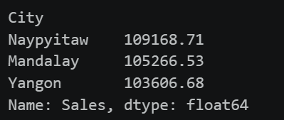
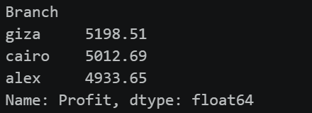
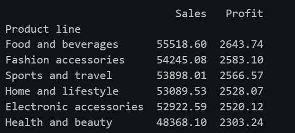

# Supermarket Sales Analysis

## 📌 Project Description

This project uses **Python and Pandas** to clean, prepare, and analyze supermarket sales data.

The dataset used in this project is:

`SuperMarket.csv`

The goal is to clean the data and answer business questions using the available sales and transaction information.

---

## 🛠️ Tools Used

* Python
* Pandas
* Matplotlib / Seaborn (Optional)
* Streamlit (Optional)

---

## 🧹 Data Cleaning

The following data-cleaning steps were performed:

* Checked data types
* Checked missing values
* Checked duplicate records
* Renamed columns
* Removed unnecessary columns
* Corrected data types
* Sorted the data
* Create 3 columns (Day, Month, Year )
* Created the `satisfied` column based on the rating

**Satisfaction Rule:**

`Rating >= 7 → Satisfied Else  → Not Satisfied`

---

## 📊 Business Analysis

### 1. Total Revenue

**Result:**

> 318,041.92

---

### 2. Revenue by City

**Highest Revenue City:**

> Naypyitaw

**Result / Screenshot:**

> 

---

### 3. Profit by Branch

**Most Profitable Branch:**

> giza

**Result / Screenshot:**

> 

---

### 4. Revenue and Profit by Product Category

**Top-Performing Category:**

> Food and beverages

**Result / Screenshot:**

> 

---

### 5. Spending by Customer Type

**Customer Type That Spends More:**

> Member

---

### 6. Payment Method

**Most Popular Payment Method:**

> cash

---

### 7. Average Transaction Value

**Average Transaction Value:**

> 321.9

---

### 8. Customer Satisfaction by Branch

**Branch with the Highest Satisfaction:**

> alex

---

### 9. Sales by Day and Month

**Highest Sales Day:**

> 9

**Highest Sales Month:**

> 3

---

### 10. Overall Customer Satisfaction

**Overall Satisfaction Percentage:**

> 50.30%

---
